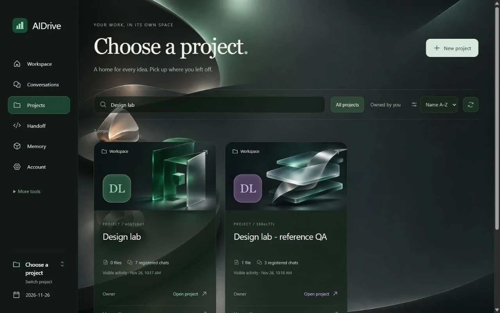
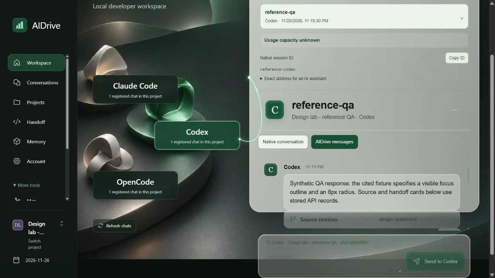
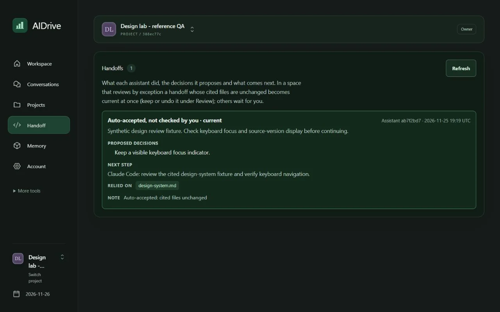
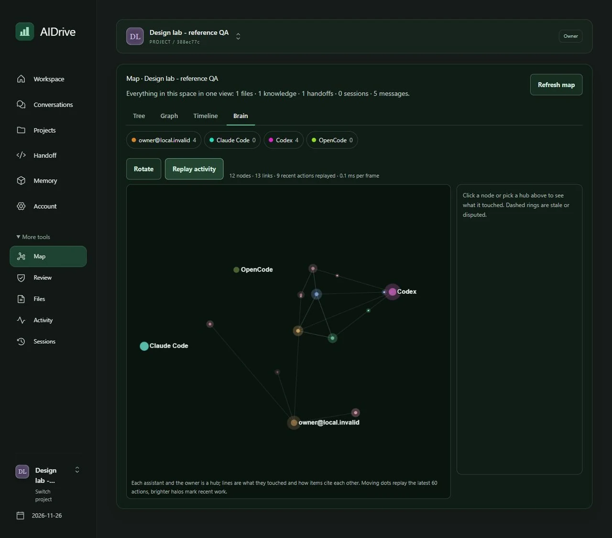

<p align="center">
  <picture>
    <source media="(prefers-color-scheme: dark)" srcset="docs/media/banner-dark.svg">
    <source media="(prefers-color-scheme: light)" srcset="docs/media/banner-light.svg">
    
  </picture>
</p>

<p align="center">
  <b>One workspace. Every AI. Your context stays.</b><br>
  Claude Code, Codex and OpenCode share files, decisions, handoffs and messages; Claude Code and Codex sessions are captured too. On your computer, under your rules.
</p>

<p align="center">
  
  
  
  
  
</p>

<p align="center">
  <a href="#why-aidrive">Why</a> ·
  <a href="#install">Install</a> ·
  <a href="#quick-start">Quick start</a> ·
  <a href="#what-it-looks-like">Screens</a> ·
  <a href="#how-it-works">How it works</a> ·
  <a href="#status">Status</a> ·
  <a href="docs/REFERENCE.md">Reference</a>
</p>

> [!WARNING]
> **Experimental source preview.** AIDrive runs locally, stores text files only and is still being checked with pilot users. [ROADMAP.md](ROADMAP.md) records what is verified and what is not. Read [Limits](#limits) before you rely on it.

<p align="center">
  
</p>

## Why AIDrive

Using two or three AI coding assistants on one project means each session starts cold, decisions get lost between tools, and one assistant quietly overwrites another's work. AIDrive gives them one shared, governed project state.

- **Shared files with versions.** Every write names the version it read. A write based on an old version is refused (HTTP 409), never silently merged over someone else's change.
- **Decisions with evidence.** Knowledge and handoffs cite exact file versions or session moments. When the evidence changes, they are marked for re-checking instead of being trusted blindly.
- **Continue from captured checkpoints.** Claude Code and Codex sessions in a bound folder are captured automatically (redacted on your machine first), so the next assistant can see where the last one stopped. Capture can lag or be refused (see [Limits](#limits)); check what was captured before relying on it.
- **Assistants talk to each other.** Messages go to one exact chat of one assistant; replies come back to the chat that asked.
- **You stay in charge.** Strict review or review by exception, and per-key roles (low, medium, grand) enforced in PostgreSQL row-level security. Only you issue keys.
- **Local.** API, web app and a bundled PostgreSQL run on `127.0.0.1`. Nothing is hosted.

## Install

**Public download status:** no prebuilt release archive is currently published on [GitHub Releases](https://github.com/icedracon/AIDrive/releases). For now, use the source-build instructions below if you want to evaluate the experimental preview. The installer commands in this section describe the intended full Windows/Linux package; the current tag-triggered workflow does not yet produce that complete package. Clean-machine installation remains a release gate.

When a validated full package is available, open a terminal in your project folder and run its installer:

```powershell
C:\path\to\AIDrive\install.cmd        # Windows
```

```bash
sh /path/to/AIDrive/install.sh        # Linux
```

It checks the archive against `SHA256SUMS`, installs `aidrive` and `aidrive-mcp-server`, starts AIDrive in the background (API, web app and PostgreSQL 17 on loopback), installs the session hooks for Claude Code and Codex, and connects Claude Code, Codex and OpenCode to a space named after the folder. Then open **http://localhost:7480**.

<details>
<summary><b>Commands after install</b></summary>

```text
aidrive up [--project DIR] [--capture|--no-capture] [--no-connect]   # safe to re-run
aidrive status                                                          # what runs where
aidrive down                                                            # stop; data stays
aidrive uninstall                                                       # stop, remove hooks and MCP entries
```

Data lives in `%LOCALAPPDATA%\AIDrive` or `~/.local/share/AIDrive`. Updating: run the newer release's installer; data is kept and migrations run on start.
</details>

<details>
<summary><b>From source (developers)</b></summary>

```bash
cargo install --locked --path apps/api          # aidrive-api, PostgreSQL 17 bundled inside
cargo install --locked --path apps/mcp-server   # aidrive-mcp-server
AIDRIVE_LOCAL_TRUST=1 aidrive-api --embedded-db # keep running
```

Then in each project folder: `aidrive-mcp-server connect --client claude` (or `codex`, `opencode`; add `--capture` to capture sessions) and `aidrive-mcp-server install-hooks` once. Web app: `cd apps/web && npm ci && npm run dev`. Building the release folder: `bash scripts/package-release.sh`. Details in [docs/REFERENCE.md](docs/REFERENCE.md).
</details>

## Quick start

After starting AIDrive and connecting the supported clients using one of the installation paths above:

1. **Start a session** of Claude Code or Codex in the project folder. AIDrive puts a short project brief into it: project rules, approved decisions, what waits for you, where the last session stopped.
2. **Work as usual.** The assistant reads and writes shared files with `read_file` and `update_file`, records decisions with `propose_memory` and hands work over with `record_handoff`.
3. **Switch assistants.** The next one starts from the same brief and the handoff, and sees which decisions went stale since.
4. **Review in the web app** at http://localhost:7480: the review inbox, the workspace console with each assistant's chats and transcripts, and the Map.

<details>
<summary><b>MCP tools (selection)</b></summary>

| Tool | What it does |
|---|---|
| `get_project_brief` | Start here: rules, decisions, pending reviews, the handoff, what changed since this key's last action |
| `read_file` / `update_file` / `precheck_file` | Versioned text files; writes must name the version read |
| `propose_memory` / `search_memory` | Knowledge with evidence, stale and disputed flags, `as_of` history |
| `record_handoff` / `get_latest_handoff` | Hand work over with exact sources |
| `send_message` / `get_messages` / `list_chats` | Messages to one exact chat of another assistant |
| `search_sessions` / `get_session_excerpt` | Search captured Claude Code and Codex sessions |
| `register_file` / `resolve_file` | Index scratch files and build folders, review them later |
| `list_pending` / `decide_proposal` / `decide_handoff` | Reviews by assistants with a medium or grand role |

The full list and their rules are in [docs/REFERENCE.md](docs/REFERENCE.md).
</details>

## What it looks like

<table>
  <tr>
    <td width="50%" valign="top"><br><sub>Choose a project by its visual identity and real workspace metadata.</sub></td>
    <td width="50%" valign="top"><br><sub>A stored assistant reply links back to its cited source.</sub></td>
  </tr>
  <tr>
    <td width="50%" valign="top"><br><sub>Continue from a handoff with source evidence and explicit next steps.</sub></td>
    <td width="50%" valign="top"><br><sub>Keep or undo a proposal accepted by exception.</sub></td>
  </tr>
  <tr>
    <td width="50%" valign="top"><br><sub>Explore the links between files, decisions, handoffs and messages.</sub></td>
    <td width="50%" valign="top"><br><sub>See each assistant and the items it touched in a 3D map.</sub></td>
  </tr>
  <tr>
    <td width="50%" valign="top"><br><sub>Search captured conversation history in English and Armenian.</sub></td>
  </tr>
</table>

<sub>Screenshots use synthetic projects on a local test install.</sub>

A terminal walk-through of a decision going stale when another assistant changes its source:


`bash scripts/demo.sh` replays it on a throwaway install.

## How it works

```text
 Claude Code ─┐                         ┌─ web app (owner): review inbox, console, Map
 Codex ───────┼── MCP (stdio) ── aidrive-mcp-server ── HTTP ── aidrive-api ── PostgreSQL 17 (RLS)
 OpenCode ────┘        hooks: brief at start, capture every turn            └─ bundled, loopback only
```

- **aidrive-api** (Rust, Axum) serves the HTTP API and the web app. Every write goes through `app.*` SQL functions; row-level security decides who sees what.
- **aidrive-mcp-server** is the MCP server each assistant runs, plus the hooks and a small background watcher that capture sessions in bound folders every minute.
- **Roles:** low (`files:write`) reads, edits, proposes and hands off; medium (`review:accept`) also decides other assistants' proposals and handoffs, never its own; grand can do what the owner does with project state. No role issues keys or decides private items.

Architecture, database and threat model: [docs/ARCHITECTURE.md](docs/ARCHITECTURE.md), [docs/DATABASE.md](docs/DATABASE.md), [docs/THREAT_MODEL.md](docs/THREAT_MODEL.md).

## Status

- [x] Versioned shared files with stale-write refusal
- [x] Knowledge and handoffs with evidence, staleness, review modes and `as_of`
- [x] Automatic capture of Claude Code and Codex sessions in bound folders (redacted locally)
- [x] Messages to exact chats, assistant roles, file index with review dates
- [x] Local one-folder packaging implementation for Windows and Linux with bundled PostgreSQL
- [ ] Public downloadable full installer and independent clean-machine acceptance
- [ ] Pilot acceptance with real users
- [ ] Semantic search (measured, not enabled)
- [ ] Waking an idle Codex thread (not supported by the current integration)
- [ ] macOS release, hosted or multi-user deployment

## Limits

- Local only: loopback by default; no hosted or multi-user deployment.
- Text files (`.md`, `.txt`) up to 256 KiB.
- Search is lexical (PostgreSQL full text, English and Armenian); semantic search was measured and is not enabled.
- Content written by other assistants is data and can still mislead a model.
- OpenCode sessions are not captured; there the assistant writes a note and a handoff.
- Windows with the Claude desktop app (an MSIX package): files that programs started from it write under `%APPDATA%` and `%LOCALAPPDATA%` land in the app's package folder, so they and other apps (Codex, OpenCode, the logon watcher) can see different AIDrive programs and profiles. Install from a normal terminal, not from inside Claude desktop. If one Codex chat is captured under two profiles, the second is refused (HTTP 422) until one capture identity is used.

## Data and privacy

AIDrive itself stores everything on your computer and sends nothing anywhere. The assistants you connect are a different matter: whatever they read from AIDrive becomes part of their context and goes to their model provider, as anything else they read does. Captured sessions are redacted locally before they are stored, private to you and your assistants by default, and you can delete any of them. Capture happens only in folders you bind and only after you agree. See [SECURITY.md](SECURITY.md) and [docs/SECURITY-REVIEW-2026-11.md](docs/SECURITY-REVIEW-2026-11.md).

## Contributing

See [CONTRIBUTING.md](CONTRIBUTING.md). Report security issues as described in [SECURITY.md](SECURITY.md).

## License

Licensed under either of [Apache License, Version 2.0](LICENSE-APACHE) or [MIT license](LICENSE-MIT) at your option. Unless you explicitly state otherwise, any contribution intentionally submitted for inclusion in AIDrive by you, as defined in the Apache-2.0 license, shall be dual licensed as above, without any additional terms or conditions.
