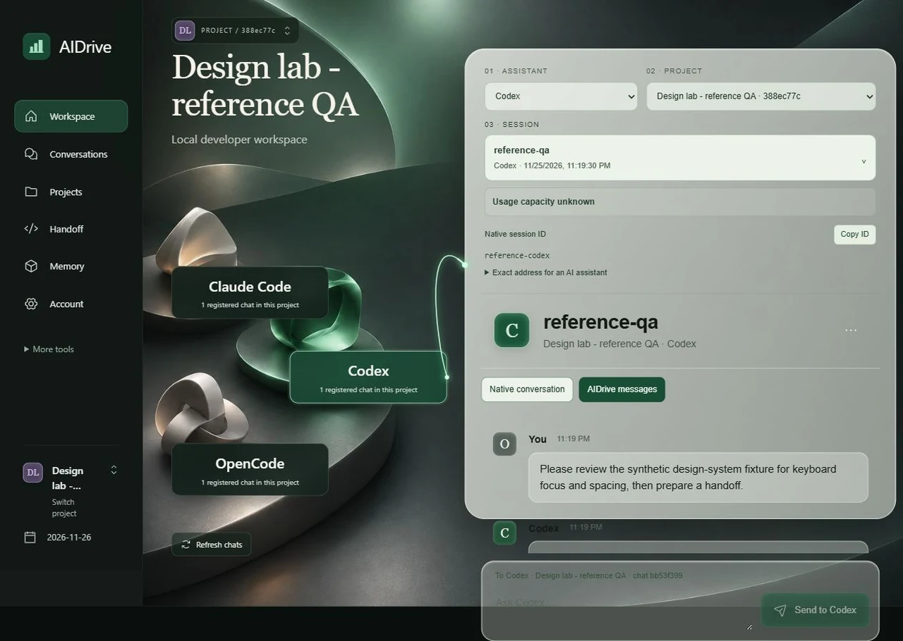
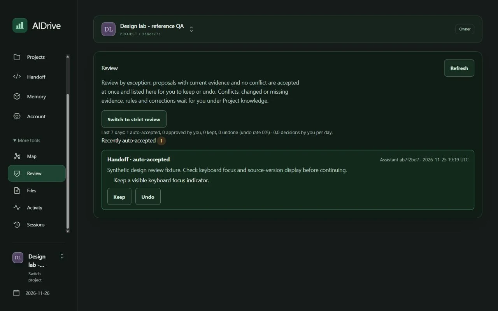
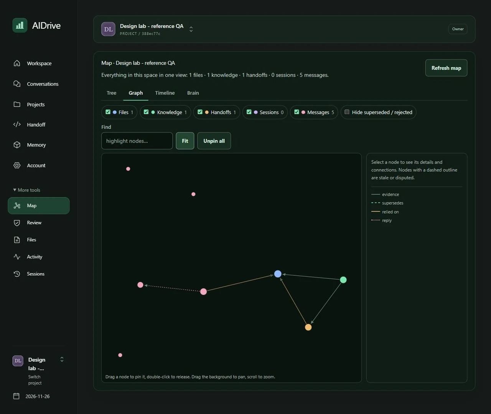
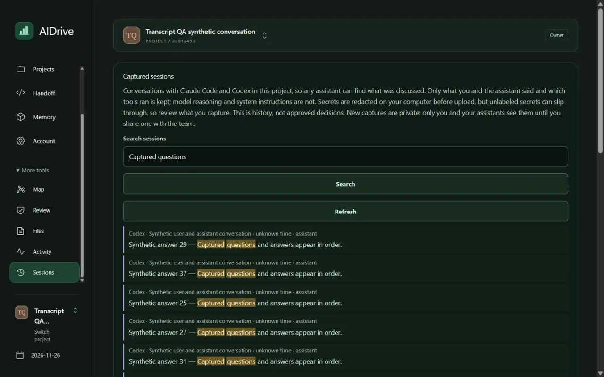

<p align="center">
  <picture>
    <source media="(prefers-color-scheme: dark)" srcset="docs/media/banner-dark.svg">
    <source media="(prefers-color-scheme: light)" srcset="docs/media/banner-light.svg">
    
  </picture>
</p>

<p align="center">
  <b>Switch assistants. Keep the project moving.</b><br>
  A local shared workspace for Claude Code, Codex and OpenCode.<br>Versioned files. Decisions with sources. Handoffs that keep their context.
</p>

<p align="center">
  
  
  <a href="https://github.com/icedracon/AIDrive/actions/workflows/ci.yml"></a>
  
</p>

<p align="center">
  <a href="#why-aidrive">Why</a> ·
  <a href="#install">Install</a> ·
  <a href="#quick-start">Quick start</a> ·
  <a href="#what-it-looks-like">Screens</a> ·
  <a href="#how-it-works">How it works</a> ·
  <a href="#status">Status</a> ·
  <a href="docs/REFERENCE.md">Reference</a>
</p>

> [!WARNING]
> **Experimental source preview.** Pilot acceptance is still open. This source publication is not a verified pilot package. [ROADMAP.md](ROADMAP.md) records what is verified and what is not. Read [Limits](#limits) before you rely on it.

<p align="center">
  
</p>

## Why AIDrive

Using two or three AI coding assistants on one project means each session starts cold, decisions get lost between tools, and one assistant quietly overwrites another's work. AIDrive gives them one shared, governed project state.

| Keep work safe | Carry context forward | Stay in control |
| :--- | :--- | :--- |
| Every write names its source version. Stale writes are refused with HTTP 409. | Handoffs and decisions cite exact sources. Changed evidence is flagged for review. | Review proposals, assign per-key roles and inspect changes in one local workspace. |

Claude Code and Codex can capture sessions in bound folders, with local redaction before storage. Messages address an **exact chat**, so choosing an assistant does not lose the project or session identity. Check [capture and delivery limits](#limits) before relying on either.

## Install

**Start from source for this preview.** No downloadable release has been published yet. You need Rust 1.92+ and Node.js for the web app; PostgreSQL 17 is bundled by the API build.

```bash
git clone https://github.com/icedracon/AIDrive.git
cd AIDrive
```

```bash
cargo install --locked --path apps/api          # aidrive-api, PostgreSQL 17 bundled inside
cargo install --locked --path apps/mcp-server   # aidrive-mcp-server
AIDRIVE_LOCAL_TRUST=1 aidrive-api --embedded-db # keep running
```

On PowerShell, first set `$env:AIDRIVE_LOCAL_TRUST="1"`, then run `aidrive-api --embedded-db`. Keep local trust on loopback.

Then in each project folder: `aidrive-mcp-server connect --client claude` (or `codex`, `opencode`; add `--capture` to capture sessions) and `aidrive-mcp-server install-hooks` once. Web app: `cd apps/web`, `npm ci`, then `npm run dev`. Open **http://localhost:3000** and restart your assistant to load MCP configuration. Building the release folder: `bash scripts/package-release.sh`. Details in [docs/REFERENCE.md](docs/REFERENCE.md).

<details>
<summary><b>Packaged installer workflow — for a built release folder</b></summary>

The packaging scripts produce one folder (or zip) for Windows and Linux; final clean-machine pilot acceptance remains open. It needs no internet, admin rights, Rust, Node.js, Docker, WSL or system PostgreSQL. Open a terminal in your project folder and run its installer:

```powershell
C:\path\to\AIDrive\install.cmd        # Windows
```

```bash
sh /path/to/AIDrive/install.sh        # Linux
```

It checks the archive against `SHA256SUMS`, installs `aidrive` and `aidrive-mcp-server`, starts AIDrive in the background (API, web app and PostgreSQL 17 on loopback), installs the session hooks for Claude Code and Codex, and connects Claude Code, Codex and OpenCode to a space named after the folder. Then open **http://localhost:7480**.

**Commands after install**

```text
aidrive up [--project DIR] [--capture|--no-capture] [--no-connect]   # safe to re-run
aidrive status                                                          # what runs where
aidrive down                                                            # stop; data stays
aidrive uninstall                                                       # stop, remove hooks and MCP entries
```

Data lives in `%LOCALAPPDATA%\AIDrive` or `~/.local/share/AIDrive`. Updating: run the newer release's installer; data is kept and migrations run on start.

</details>

## Quick start

1. **Start a session** of Claude Code or Codex in the project folder. AIDrive puts a short project brief into it: project rules, approved decisions, what waits for you, where the last session stopped.
2. **Work as usual.** The assistant reads and writes shared files with `read_file` and `update_file`, records decisions with `propose_memory` and hands work over with `record_handoff`.
3. **Switch assistants.** The next one starts from the same brief and the handoff, and sees which decisions went stale since.
4. **Review in the web app** (port 3000 from source, 7480 in a package): the review inbox, the workspace console with each assistant's chats and transcripts, and the Map.

<details>
<summary><b>MCP tools (selection)</b></summary>

| Tool | What it does |
|---|---|
| `get_project_brief` | Start here: rules, decisions, pending reviews, the handoff, what changed since this key's last action |
| `read_file` / `update_file` / `precheck_file` | Versioned text files; writes must name the version read |
| `propose_memory` / `search_memory` | Knowledge with evidence, stale and disputed flags, `as_of` history |
| `record_handoff` / `get_latest_handoff` | Hand work over with exact sources |
| `send_message` / `get_messages` / `list_chats` | Messages to one exact chat of another assistant |
| `search_sessions` / `get_session_excerpt` | Search captured Claude Code and Codex sessions |
| `register_file` / `resolve_file` | Index scratch files and build folders, review them later |
| `list_pending` / `decide_proposal` / `decide_handoff` | Reviews by assistants with a medium or grand role |

The full list and their rules are in [docs/REFERENCE.md](docs/REFERENCE.md).
</details>

## What it looks like

**Choose the assistant, then the project and exact chat.**

<p align="center">
  
</p>

| Continue the work | Review the evidence |
| :--- | :--- |
|  |  |

<details>
<summary><b>Explore messages, maps and captured-session search</b></summary>

**Messages** — a stored reply with its cited source. This image does not prove an idle assistant was awakened.


**Knowledge map** — relationships between files, decisions and handoffs.



**3D map** — assistants and the items they touched.


**Session search** — captured conversation history in English and Armenian.



</details>

<sub>All screenshots use synthetic projects on a local test install.</sub>

<details>
<summary><b>Watch a decision become stale when its source changes</b></summary>


`bash scripts/demo.sh` replays the terminal demonstration on a throwaway install.

</details>

## How it works

```text
 Claude Code ─┐                         ┌─ web app (owner): review inbox, console, Map
 Codex ───────┼── MCP (stdio) ── aidrive-mcp-server ── HTTP ── aidrive-api ── PostgreSQL 17 (RLS)
 OpenCode ────┘        hooks: brief at start, capture every turn            └─ bundled, loopback only
```

- **aidrive-api** (Rust, Axum) serves the HTTP API and the web app. Every write goes through `app.*` SQL functions; row-level security decides who sees what.
- **aidrive-mcp-server** is the MCP server each assistant runs, plus the hooks and a small background watcher that capture sessions in bound folders every minute.
- **Roles:** low (`files:write`) reads, edits, proposes and hands off; medium (`review:accept`) also decides other assistants' proposals and handoffs, never its own; grand can do what the owner does with project state. No role issues keys or decides private items.

Architecture, database and threat model: [docs/ARCHITECTURE.md](docs/ARCHITECTURE.md), [docs/DATABASE.md](docs/DATABASE.md), [docs/THREAT_MODEL.md](docs/THREAT_MODEL.md).

## Status

- [x] Versioned shared files with stale-write refusal
- [x] Knowledge and handoffs with evidence, staleness, review modes and `as_of`
- [x] Automatic capture of Claude Code and Codex sessions in bound folders (redacted locally)
- [x] Messages to exact chats, assistant roles, file index with review dates
- [x] One-folder install for Windows and Linux with bundled PostgreSQL
- [ ] Pilot acceptance with real users
- [ ] Semantic search (measured, not enabled)
- [ ] Waking an idle Codex thread (not supported by the current integration)
- [ ] macOS release, hosted or multi-user deployment

## Limits

- Local only: loopback by default; no hosted or multi-user deployment.
- Text files (`.md`, `.txt`) up to 256 KiB.
- Search is lexical (PostgreSQL full text, English and Armenian); semantic search was measured and is not enabled.
- Content written by other assistants is data and can still mislead a model.
- OpenCode sessions are not captured; there the assistant writes a note and a handoff.
- Windows with the Claude desktop app (an MSIX package): files that programs started from it write under `%APPDATA%` and `%LOCALAPPDATA%` land in the app's package folder, so they and other apps (Codex, OpenCode, the logon watcher) can see different AIDrive programs and profiles. Install from a normal terminal, not from inside Claude desktop. If one Codex chat is captured under two profiles, the second is refused (HTTP 422) until one capture identity is used.

## Data and privacy

AIDrive itself stores everything on your computer and sends nothing anywhere. The assistants you connect are a different matter: whatever they read from AIDrive becomes part of their context and goes to their model provider, as anything else they read does. Captured sessions are redacted locally before they are stored, private to you and your assistants by default, and you can delete any of them. Capture happens only in folders you bind and only after you agree. See [SECURITY.md](SECURITY.md) and [docs/SECURITY-REVIEW-2026-11.md](docs/SECURITY-REVIEW-2026-11.md).

## Contributing

See [CONTRIBUTING.md](CONTRIBUTING.md). Report security issues as described in [SECURITY.md](SECURITY.md).

## MCP Registry preparation

- Intended MCP Registry name: `mcp-name: io.github.icedracon/aidrive`
- [server.json](server.json) describes the current `0.0.1` Cargo package and stdio launch command. This is prepared metadata, not a published registry listing.
- Registry installation supplies the MCP client only. Start the local API separately and provide its URL, workspace ID and a scoped agent key. The regular `connect` workflow above manages profiles for supported assistants.

## License

Licensed under either of [Apache License, Version 2.0](LICENSE-APACHE) or [MIT license](LICENSE-MIT) at your option. Unless you explicitly state otherwise, any contribution intentionally submitted for inclusion in AIDrive by you, as defined in the Apache-2.0 license, shall be dual licensed as above, without any additional terms or conditions.
