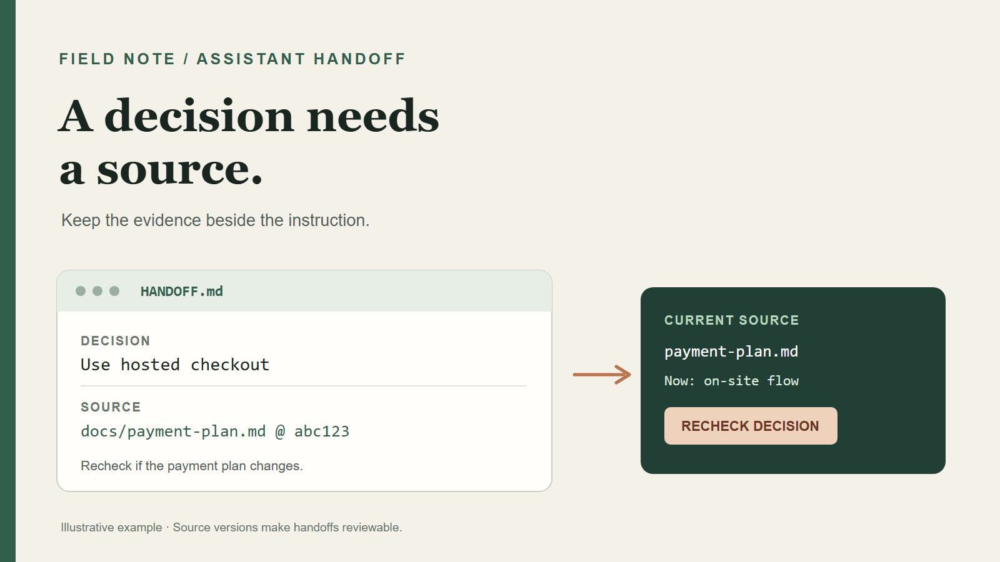

# A handoff file for switching between Claude Code and Codex

Codex can faithfully implement yesterday's decision after the source behind it has changed.

Imagine Claude Code chose a hosted checkout after reading `docs/payment-plan.md`. The next day, that file changes to require an on-site flow. Codex opens the handoff, sees "use hosted checkout," and continues. The handoff preserved the decision but lost the condition that made it valid.

When you switch assistants, the code is there. The reason for the last decision, the failed attempt, and the unfinished edit may be buried in the previous chat.

A short handoff file helps. It needs to tell the next assistant what to verify before it acts. Here is a template you can use with either tool today, without installing anything.



*Example handoff. The project and source version are illustrative.*

## Copy this template

Save this as `HANDOFF.md` in your project. Keep secrets and private conversation out of it if the repository will be shared.

```md
# Handoff

Updated: YYYY-MM-DD HH:MM UTC
From: Claude Code / Codex
To: Claude Code / Codex
Task: One sentence describing the current objective.
State: READY / IN PROGRESS / BLOCKED

## Verified state
- Git commit: <full SHA>; working tree: clean / list uncommitted paths.
- Changed: <file and exact behavior changed>.
- Checks run: <command> -> <result>; <command> -> <result>.
- Not checked: <important test or environment not covered>.

## Decisions and evidence
- Decision: <what was chosen>.
  Why: <reason and rejected alternative>.
  Source: <file path + commit, content hash, or other exact version checked>.
  Recheck if: <source changes or a specific assumption stops holding>.

## Open work
- Incomplete edit: <path and what remains>.
- Failed attempt: <what was tried, result, why not to repeat it>.
- Next action: <one concrete action and its expected result>.

## Before editing
- Run `git status --short` and `git log -1 --format=%H`.
- Read each cited source at its current version. If it changed, revisit the decision.
- If the state is BLOCKED or another assistant is still editing, stop and coordinate first.
```

The `READY` marker is a statement by the previous assistant, not a lock. If two agents can write at the same time, use separate worktrees or a real lock/approval mechanism. A Markdown file alone cannot prevent simultaneous edits.

## How to use it

Before ending a session, ask the current assistant to write the handoff **after** its last edit and checks. Review the file yourself, especially the `Verified state` and `Not checked` lines. At the start of the next session, ask the new assistant to read it, compare the cited paths and commit with the current repository, and state what it will do before changing anything.

You can give the next assistant this prompt:

> Read `HANDOFF.md` and check its commit, working tree, and cited sources against the current repository. Tell me which decisions are still supported, which need rechecking, and the next action before you edit.

If the cited `docs/payment-plan.md` changes to require an on-site flow, revisit the checkout decision before editing. The handoff should name the source version and the condition that makes the decision stale. A pleasant summary without those details can make an outdated decision sound current.

Keep the file short. Put stable project rules in `AGENTS.md` or `CLAUDE.md`; keep this file about the current task. Replace the handoff when work moves on. Git history can show code changes; the handoff should preserve the decision and its evidence.

## Where AIDrive fits

I'm building [AIDrive](https://github.com/icedracon/AIDrive) for this workflow. It stores shared text files with versions, ties decisions and handoffs to their source versions, flags changed evidence, and refuses writes based on an old version. The template above remains useful if you prefer plain files or want to decide whether the extra machinery is worth installing.

AIDrive is an experimental local preview for Windows and Linux. Final clean-machine package acceptance remains open; read its [current status](https://github.com/icedracon/AIDrive#status) and [limits](https://github.com/icedracon/AIDrive#limits) before trying it. The existing [terminal demo](https://github.com/icedracon/AIDrive#what-it-looks-like) uses a synthetic project and an MCP driver; it is not a recording of two actual assistant clients.

Try the template on your next assistant switch. If a changed source still slips through, [tell me what changed and what the handoff missed](https://github.com/icedracon/AIDrive/issues).
